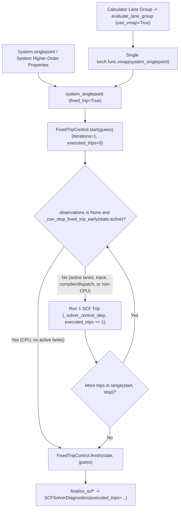

# Transform-Compatible SCF Early Stopping for Higher-Order Derivatives

*   **Author**: marvinfriede
*   **Status**: Draft
*   **Date**: 2026-11-12

--------------------------------------------------------------------------------

## Overview

`dxtb` is a differentiable extended tight-binding quantum chemistry package built on PyTorch. Every iterative (`GFN1-xTB` or `GFN2-xTB`) energy or property calculation seeks a self-consistent field (SCF) solution: starting from an initial charge, potential, or Fock guess, the solver repeatedly applies the SCF map (building an electronic Hamiltonian, diagonalizing it, computing orbital occupations, and evaluating the residual) and proposes the next SCF variable through an SCF converger until certification succeeds or an upper limit (`maxiter`, typically `50` or `100`) is reached.

`dxtb` exposes two user-facing execution surfaces backed by two SCF controllers in `src/dxtb/_src/scf/solver.py`:

*   **`System` (`src/dxtb/_src/calculators/model.py`)**: An immutable, functional `@dataclass` interface designed for `torch.func` composable transforms (`grad`, `jvp`, `vjp`, `jacrev`, `jacfwd`, and `vmap`). Methods such as `System.forces`, `System.hessian`, `System.pol_deriv`, and `System.hyperpolarizability` differentiate `System.singlepoint` through first, second, and third order using the Fixed-trip controller (`_solve_map_control` / `FixedTripControl`).
*   **`Calculator` (`src/dxtb/_src/calculators/types/energy.py`, `src/dxtb/_src/calculators/lane_evaluation.py`)**: A high-level interface supporting single molecules and multi-molecule batches. Single-molecule independent evaluations (`fixed_trip=False` in `_singlepoint_eager` and `_evaluate_prevalidated`) use the Eager controller (`_solve_map_control_eager`), which supports multi-stage strategies and stops on the host as soon as the lane is no longer active. When a batch contains multiple molecules ("lanes") forming a `can_vmap_system`-eligible homogeneous lane group, `Calculator` runs a mapped evaluation via `torch.func.vmap` over `system_singlepoint`, which uses the Fixed-trip controller.

By default, `dxtb` uses the Unrolled differentiation mode (`differentiation="unrolled"`), differentiating through every iteration that ran. Under `FixedTripControl`, converged or terminally failed lanes are frozen via per-lane `torch.where(state.active, ...)` masking. Today, however, `FixedTripControl.advance` unconditionally runs all `maxiter` trips even after every lane in the evaluation is already inactive.

This design stops CPU fixed-trip SCF loops as soon as no lane in the evaluation remains active — across single-system higher-order derivatives and mapped `vmap` lane groups alike — while preserving exact finite-trajectory values and derivatives, unifying mapped `Calculator` lane groups onto a single `vmap` call, and falling back automatically to the static `maxiter` schedule under symbolic compilers or non-CPU devices.

## The Problem

Users configure `maxiter` (commonly `50` or `100`) as a safety ceiling so difficult molecular geometries do not fail prematurely, even though typical molecules converge in `10` to `20` SCF iterations. Because `FixedTripControl.advance` currently runs all `maxiter` trips unconditionally, users pay the full `maxiter` computational and memory cost on every `System` evaluation and transformed mapped `Calculator` group regardless of how quickly SCF converges:

1.  **Wasted Higher-Order Derivative Work and Memory**: Once a molecule is certified converged after $K$ trips (`iterations == K + 1`), `state.active` becomes `False` and `torch.where` freezes every subsequent state update. Despite having zero effect on the returned SCF solution or its analytical derivatives, the remaining `maxiter - K` trips still construct Hamiltonians, differentiate dense symmetric eigensolvers through first, second, or third order, differentiate fixed-step Fermi occupation Newton iterations, and evaluate Anderson/CDIIS linear solves or Broyden low-rank updates. On `LiH` third-order hyperpolarizability (`System.hyperpolarizability`, `GFN1-xTB`, float64, CPU, `maxiter=100`), SCF converges in `13` iterations (`12` trips), so `88` of `100` differentiated trips are wasted (`~46 s` wall time at `maxiter=100` versus `~10 s` at `maxiter=20`, alongside proportional AD-graph memory growth).
2.  **Duplicated Workaround Logic in Mapped `Calculator` Evaluation**: Because `vmap(system_singlepoint)` previously could not exit early, `src/dxtb/_src/calculators/lane_evaluation.py` maintains roughly `220` lines of custom 1-trip `vmap` chunking (`_evaluate_group_adaptive`) that enters and exits `torch.func.vmap` once per trip to check activity on the host. This workaround applies only when no outer `torch.func` transform is active, adds `K + 1` extra `vmap` boundary crossings per group, and requires manual PyTree carry/restore plumbing.
3.  **Zero-Trip `trajectory_status` Discrepancy When `record_initial_status=False`**: When `_initialize_solver_control` runs with `maxiter > 0` and `record_initial_status=False`, `trajectory_status` starts as `None` and is first populated on trip `0`. If early stopping skips trip `0` because every lane failed terminally on the initial SCF map (or `advance` runs an empty `start == stop` slice), `SCFSolveResult.trajectory_status` remains `None` instead of carrying the inactive status PyTree produced by a static run.
4.  **Opaque Physical Trip-Count Diagnostics at the SCF Boundary**: `SCFSolveResult.iterations` counts active SCF maps per lane (for example, `13` after the initial map plus `12` active trips), whether `FixedTripControl.advance` physically stopped after `12` trips or executed all `100` trips under a static-schedule fallback. Direct SCF callers and tests lack a built-in diagnostic distinguishing executed loop trips from per-lane active iterations.

## Goals

*   **Eliminate Inactive CPU SCF Trips Under Function Transforms**: Stop `FixedTripControl.advance` on CPU (`device.type == "cpu"`) when trace recording is disabled (`record_trace=False`) as soon as every lane in the active single-system or `vmap`-mapped evaluation has `state.active == False`, including under nested `autograd`, `grad`, `jvp`, `vjp`, `jacrev`, `jacfwd`, and `vmap` compositions.
*   **Preserve Finite-Trajectory Mathematical Identity**: Produce identical primal energies, charges, potentials, iteration counts, and first- through third-order analytical derivatives (`atol=0.0, rtol=0.0`, modulo IEEE-754 signed zero `-0.0` vs `+0.0` on masked reverse-mode paths) compared to running all `maxiter` trips.
*   **Preserve `SCFSolveResult` Leaf Schema Across Zero-Trip Exits**: Populate the inactive `trajectory_status` identity in `_initialize_solver_control` when `maxiter > 0` and `not record_initial_status` so `SCFSolveResult` tensor leaves match static execution even when `0` trips execute.
*   **Unify Mapped `Calculator` Lane Groups onto Single-Pass `vmap`**: Route all `vmap`-eligible lane groups in `evaluate_lane_group` through a single `torch.func.vmap` invocation and retire the 1-trip `_evaluate_group_adaptive` chunking layer and its orphaned adapter.
*   **Automatic Compiler and Device Fallback**: Detect symbolic tracing, graph compilation (`torch.compile`, `torch.jit.trace`), `FunctionalTensor` wrapping, Python dispatch modes, and non-CPU tensor devices automatically without user-facing configuration flags, executing the static `maxiter` loop when host boolean inspection is unsafe or out of scope.
*   **Expose Physical Trip Counts on `SCFSolverDiagnostics`**: Record the number of physically executed trips/iterations as a host Python `int` (`executed_trips`) on `SCFSolverDiagnostics` without adding tensor leaves to `SCFSolveResult`, `Result`, or `SCFStatus`.

## Non-Goals

*   **GPU / Non-CPU Early-Stopping Optimization**: Reading `state.active` on GPU forces a device-to-host stream synchronization and breaks `torch.cuda.CUDAGraph` stream capture. Non-CPU `System` evaluations remain on the static `maxiter` schedule, and untransformed/autograd non-CPU mapped `Calculator` lane groups intentionally move from uncalibrated 1-trip host-synced chunking to the static `maxiter` schedule until calibrated multi-trip GPU polling is benchmarked on GPU hardware.
*   **Changes to `differentiation="implicit"` or Convergence Criteria**: Implicit differentiation (`src/dxtb/_src/scf/implicit.py`, `src/dxtb/_src/scf/eager.py`), SCF tolerances (`x_atol`, `x_atol_max`, `SCFCertificationThresholds`), and fixed-step Fermi occupation Newton iterations (`src/dxtb/_src/wavefunction/filling.py`) are unchanged.
*   **Early Stopping When `record_trace=True`**: Diagnostic trace recording (`observations is not None`) is used by internal SCF tests that assert fixed `1 + maxiter` trace dimensions in `SCFSolverTrace`; trace-recording runs continue executing all `maxiter` trips.
*   **Changing Single-Molecule Independent `Calculator` Routing**: Single-molecule `Calculator` calls (`fixed_trip=False` in `_singlepoint_eager` and `_evaluate_prevalidated`, including single-molecule `Calculator.hyperpolarizability(..., use_functorch=True)`) continue using the Eager controller (`_solve_map_control_eager`).

## Open Questions

*   None.

## Critical User Journeys (CUJs)

### CUJ 1: Higher-Order Property Evaluation with Standard `maxiter` Budgets

*   **Given**: A user or workflow configures a molecule or homogeneous conformer batch on CPU in float64 with `GFN1-xTB` or `GFN2-xTB`, `differentiation="unrolled"`, and `maxiter=100` (for example, `LiH`, which converges in `13` SCF iterations, i.e., `12` trips after `start()`).
*   **When**: The user evaluates `System.hyperpolarizability`, `System.pol_deriv`, `System.hessian`, or mapped `Calculator.hyperpolarizability(..., use_functorch=True)` over an eligible multi-molecule lane group (`numbers.ndim > 1`).
*   **Then**: `FixedTripControl.advance` exits immediately after trip `12` once `state.active` becomes `False` across all lanes, SCF-layer `SCFSolverDiagnostics.executed_trips` records `12` rather than `100`, the returned property tensor and downstream derivatives match the `100`-trip trajectory, and wall-clock runtime tracks the converged trip count rather than `maxiter`.

### CUJ 2: Mapped Evaluation Across Heterogeneous Convergence Speeds

*   **Given**: A user evaluates a homogeneous group of molecules on CPU via `torch.func.vmap(system.singlepoint)` (with or without outer `jacrev`/`jacfwd` transforms) or via `Calculator` mapped lane groups where individual lanes reach `SCFSolveResult.iterations` between `8` and `15` under `maxiter=100`.
*   **When**: `evaluate_lane_group` or the caller's `vmap` invocation executes the mapped SCF solve.
*   **Then**: The lane group runs inside a single `vmap` pass without per-trip `vmap` re-entry, lanes that converge at iteration `8` (`7` trips) remain frozen via `torch.where` while remaining active lanes continue, the loop exits after `14` trips once the slowest lane reaches iteration `15` and becomes inactive, and `SCFSolveResult.iterations` reports each lane's individual iteration count (`8` through `15`).

### CUJ 3: Symbolic Compilation and Non-CPU Static-Schedule Fallback

*   **Given**: A caller traces `System.singlepoint` under `torch.compile`, `torch.jit.trace`, or `torch.func.functionalize`, or runs `System` or mapped `Calculator` lane groups on a non-CPU device (such as `cuda` or `meta`).
*   **When**: `FixedTripControl.advance` executes the SCF loop.
*   **Then**: The controller detects that host CPU unwrapping is unavailable without requiring any `ConfigSCF` flag change, executes all `maxiter` trips without graph breaks or device-to-host synchronizations, preserves per-lane results via `torch.where`, and records `executed_trips == maxiter` on `SCFSolverDiagnostics`.

## Technical Plan (Architecture)

### Architectural Overview and Data Flow

Both functional `System` calls (including nested `grad`, `jvp`, `vjp`, `jacrev`, `jacfwd`, and `vmap` transforms) and mapped `Calculator` lane groups (`evaluate_lane_group` when `group.use_vmap` is `True`) share one fixed-trip SCF lifecycle in `src/dxtb/_src/scf/solver.py`: `FixedTripControl.start`, `FixedTripControl.advance`, and `FixedTripControl.finish` (orchestrated by `_solve_map_control`).



### Why Stopping Inactive Trips Preserves Finite-Trajectory Derivatives

In `FixedTripControl.start`, the initial SCF map evaluates the starting guess (`iterations = 1`, `active = ~initial_terminal`, `executed_trips = 0`). On each scheduled trip in `FixedTripControl.advance`, `_solver_control_step` increments `iterations` for active lanes and `executed_trips` on the host, evaluates certification (which checks both SCF variable residual and orthogonalized electronic commutator stationarity), and updates `state.active = state.active & ~certified_event & ~terminal_event`. Consequently, CPU early-stopped solves that start active satisfy `executed_trips == max(iterations) - 1` (`0` trips only when all lanes fail terminally on the initial SCF map or `start == stop`), whereas static-schedule fallback runs execute `executed_trips == maxiter`.

Because `state.active` is combined via logical AND on every trip, once a lane becomes inactive at trip $K_{\text{lane}}$, it remains `False` for all subsequent trips. Every accepted state tensor in `_solver_control_step` — `current_x`, `map_input_x`, `map_result`, `residual`, `iterations`, `converger_state`, `damping_state`, `trajectory_status`, and `certification` — is selected through `torch.where(mask, candidate_branch, frozen_branch)` where `mask` is `state.active` or `converger_active` (a subset of `state.active`). When `state.active == False` across every lane in the evaluation:

*   **Primal value invariance**: `torch.where(False, candidate_branch, frozen_branch)` returns `frozen_branch` bit-for-bit.
*   **Arbitrary-order derivative invariance**: Forward-mode (`jvp`, `jacfwd`) rules for `torch.where` select `frozen_branch` tangents directly and reverse-mode (`autograd`, `vjp`, `jacrev`) rules route zero cotangents to `candidate_branch`, contributing zero to every derivative order (aside from IEEE-754 signed-zero normalization `-0.0 + (+0.0) -> +0.0` in reverse accumulation when an upstream cotangent is `-0.0`).

Executing $K = \max_{\text{lane}} K_{\text{lane}}$ trips therefore evaluates the identical mathematical function and derivatives as executing all `maxiter` trips, without materializing the remaining `maxiter - K` Hamiltonian, eigensolver, Fermi-occupation, or converger AD graphs.

### Component 1: Hardened Transform-Wrapper Unwrapping (`src/dxtb/_src/utils/tensors.py`)

`unwrap_functorch_tensor(tensor, *, allow_vmap=False)` peels C++ `torch._C._functorch` wrappers (`GradTrackingTensor` and, when `allow_vmap=True`, `BatchedTensor`) so host control logic can read underlying boolean storage without triggering `BatchedTensor` conversion errors or functorch dispatch interception. Before enabling `allow_vmap=True` inside `FixedTripControl`, its rejection contract is tightened in two ways while keeping its signature unchanged:

1.  **Unconditional `FunctionalTensor` Rejection**: `FunctionalTensor` wrappers are rejected (`return None`) regardless of `allow_vmap`, preserving `torch.func.functionalize` and AOT compiler tracing.
2.  **Residual Wrapper Guard**: Because functorch C++ wrapper tensors still report `Tensor` as their Python `type`, the unwrapped return value is accepted only when no C++ functorch wrapper layer remains after bounded unwrapping; otherwise `None` is returned.

### Component 2: CPU Early-Exit Gate in `FixedTripControl.advance` (`src/dxtb/_src/scf/solver.py`)

A dedicated helper `_can_stop_fixed_trip_early(active: Tensor) -> bool` encapsulates the host early-exit predicate in `src/dxtb/_src/scf/solver.py` (giving A/B parity tests and emergency rollback a single isolation point). When `observations is None`:

*   `unwrap_functorch_tensor(active, allow_vmap=True)` unwraps `GradTrackingTensor` and `BatchedTensor` layers; if unwrapping returns `None` (active compiler, `jit.trace`, `FunctionalTensor`, `TorchDispatchMode`, or `__torch_function__` tensor subclass), `_can_stop_fixed_trip_early` returns `False`.
*   Inside `disable_functorch()` (`src/dxtb/_src/utils/tensors.py`), if the unwrapped tensor is on CPU (`device.type == "cpu"`) and `not bool(raw_active.any())`, `_can_stop_fixed_trip_early` returns `True`; non-CPU tensors return `False` without host synchronization.
*   `FixedTripControl.advance` checks this gate both before initial problem unwrapping (short-circuiting `0`-trip initial-terminal or already-finished chunk slices) and before each scheduled trip when `observations is None`.

### Component 3: Zero-Trip `trajectory_status` Parity (`src/dxtb/_src/scf/solver.py`)

Once `_evaluate_group_adaptive` is removed (Component 4), internal `_SolverControlState` no longer crosses a `vmap` boundary, `SCFSolveResult` never exposes `converger_state`, and `FixedTripControl.finish` already computes `certification` whenever `maxiter > 0` even after `0` executed trips. Only `trajectory_status` would remain `None` on a `0`-trip initial-terminal exit when `maxiter > 0` and `record_initial_status=False` (where `record_initial_status` controls whether initial-guess Fermi/electron flags are folded into trajectory status). Initializing `trajectory_status` to the inactive identity element via `accumulate_trajectory_status` inside `_initialize_solver_control` guarantees identical `SCFSolveResult` tensor leaves across `0`-trip and multi-trip runs while keeping `converger_state` and `certification` lazily `None` in `start()`.

### Component 4: Unified Single-Pass `vmap` Lane Groups (`src/dxtb/_src/calculators/lane_evaluation.py`, `src/dxtb/_src/scf/eager.py`)

Because `FixedTripControl.advance` now exits early on CPU under `BatchedTensor` (`allow_vmap=True`), external 1-trip `vmap` chunking in `src/dxtb/_src/calculators/lane_evaluation.py` is redundant on CPU. `evaluate_lane_group` routes every `group.use_vmap` group through one `torch.func.vmap` call:

```python
mapped = torch.func.vmap(
    partial(system_singlepoint, group.system), in_dims=in_dims
)(*args)
```

The custom 1-trip chunking layer in `lane_evaluation.py` and its orphaned `fixed_trip_control` adapter in `src/dxtb/_src/scf/eager.py` are deleted. On CPU, mapped `Calculator` groups execute a single `vmap` entry/exit and stop after the slowest active lane in both untransformed and `torch.func`-transformed calls; on non-CPU devices, mapped groups execute the static `maxiter` schedule without per-trip host synchronizations.

### Component 5: SCF-Layer `executed_trips` Diagnostics (`src/dxtb/_src/scf/solver.py`)

To distinguish per-lane active SCF maps (`SCFSolveResult.iterations`, a `Tensor`) from physically executed controller passes without altering `vmap`-returned PyTree tensor leaves:

*   `_SolverControlState` tracks `executed_trips: int = 0`, incremented once per physically executed pass in `_solver_control_step` (covering both `FixedTripControl.advance` trips and `_solve_map_control_eager` iterations, carried across multi-stage transitions).
*   `_SolverOutcome` and `SCFSolverDiagnostics` expose `executed_trips: int | None = None` at the SCF solver boundary (`solve_scf_*`, `finalize_fixed_trip_problem`, `run_system_fixed_trip`).
*   Because `tensor_leaves` (`src/dxtb/_src/scf/core.py`) inspects only `Tensor` fields and `Result` / `SCFStatus` remain untouched, `executed_trips` is invisible to `vmap` output batching and tensor-leaf parity checks.

## Alternatives Considered

### Alternative A: Rely Solely on `differentiation="implicit"` Without Optimizing `unrolled`

*   **Pros**: Requires zero changes to `FixedTripControl`; Implicit differentiation solves one CPSCF / Z-vector linear system at the converged SCF solution instead of differentiating through SCF iterations.
*   **Cons**: `differentiation="unrolled"` is the default differentiation mode across `dxtb`, defines the finite-trajectory derivative contract when trajectories terminate before full stationarity, and supports `vmap` workflows not handled by single-system `run_prepared_implicit_scf` (`src/dxtb/_src/scf/eager.py`). Leaving `unrolled` unoptimized keeps `88%` of SCF trips wasted on converged `maxiter=100` runs such as `LiH` hyperpolarizability.
*   **Reason for Rejection**: `differentiation="unrolled"` must remain fast and memory-bounded on CPU without forcing callers onto `differentiation="implicit"`.

### Alternative B: Restrict Early Stopping to Unbatched Single-System AD Only (Exclude `vmap`)

*   **Pros**: Avoids peeling `BatchedTensor` layers (`allow_vmap=False`) and avoids straggler coupling across mapped lanes.
*   **Cons**: Leaves `torch.func.vmap(system.singlepoint)` and transformed mapped `Calculator` lane groups executing all `maxiter` trips even when every molecule in the group has already converged, and forces `lane_evaluation.py` to retain `_evaluate_group_adaptive` for untransformed CPU batches.
*   **Reason for Rejection**: Early stopping must cover both single-system transforms and mapped `vmap` groups on CPU via `unwrap_functorch_tensor(..., allow_vmap=True)` so mapped evaluations benefit equally and `_evaluate_group_adaptive` can be retired.

### Alternative C: Pre-Allocate `converger_state` and `certification` in `FixedTripControl.start`

*   **Pros**: Gives internal `_SolverControlState` identical PyTree leaf counts before and after trip `0` even when `mix_guess=False`.
*   **Cons**: Adds an `initial_state` protocol method across five converger modules (`converger.py`, `anderson.py`, `broyden.py`, `cdiis.py`, `soscf.py`), alters step-1 history seeding in Anderson and Broyden, and runs an extra Hamiltonian rebuild plus orthogonalized commutator inside `_certify_scf_core_state_primal` on every solve — which falls back to fully differentiated `certify_scf_core_state` under `vmap` (`_unwrap_gradtracking_tree` uses `allow_vmap=False`) despite being overwritten on trip `0` and in `finish()`.
*   **Reason for Rejection**: Internal `_SolverControlState` no longer crosses `vmap` boundaries once `_evaluate_group_adaptive` is removed, and `FixedTripControl.finish` already computes `certification` on `0`-trip exits; initializing only `trajectory_status` in `_initialize_solver_control` preserves `SCFSolveResult` leaf parity with three lines in `solver.py`.

### Alternative D: Retain `_evaluate_group_adaptive` in `lane_evaluation.py` Alongside Inner Early Stopping

*   **Pros**: Preserves existing monkeypatch targets in `test/test_calculator/test_grouped_adaptive_control.py` and `benchmarks/vmap_vs_eager_groups.py`, and keeps 1-trip host-sync stopping on non-CPU mapped groups.
*   **Cons**: Maintains `~220` lines of manual PyTree leaf extraction and reconstruction, enters and exits `torch.func.vmap` `K + 2` times instead of once per CPU group, checks `active.any()` twice per trip on untransformed CPU groups, and performs uncalibrated 1-trip device-to-host synchronizations on non-CPU devices without `CUDAGraph` stream-capture guards.
*   **Reason for Rejection**: Unifying mapped `Calculator` groups onto a single `torch.func.vmap` call removes duplicated machinery during the CPU-only restructuring phase rather than carrying two overlapping stopping layers.

### Alternative E: Add a User-Facing `ConfigSCF` Flag to Toggle Fixed-Trip Early Stopping

*   **Pros**: Allows callers to opt into static `maxiter` execution explicitly through `ConfigSCF`.
*   **Cons**: Expands public configuration surface and documentation for an execution detail that does not alter primal values or analytical derivatives, while callers under `torch.compile` would face graph-break errors if they forgot to flip the flag.
*   **Reason for Rejection**: Automatic compiler, tracing, dispatch-mode, and device detection selects the static schedule without exposing a redundant configuration flag (internal parity tests monkeypatch `_can_stop_fixed_trip_early`).

### Alternative F: Allow Host Boolean Reads (`bool(raw_active.any())`) on CUDA and Other Non-CPU Devices

*   **Pros**: Reduces trailing SCF kernel launches on GPU when all lanes converge well before `maxiter`.
*   **Cons**: Reading `raw_active.any()` on CUDA forces a GPU-to-CPU stream synchronization on every trip, stalls asynchronous kernel pipelining, breaks `torch.cuda.CUDAGraph` stream capture, and cannot be benchmarked on the CPU-only test environment.
*   **Reason for Rejection**: Hardware scope is restricted to CPU (`raw_active.device.type == "cpu"`), keeping non-CPU execution free of host synchronizations until multi-trip GPU polling can be benchmarked on GPU hardware.

### Alternative G: Store `executed_trips` as a `Tensor` Leaf on `SCFSolverDiagnostics`

*   **Pros**: Keeps every field of `SCFSolverDiagnostics` as a `Tensor`.
*   **Cons**: Adding a `Tensor` `executed_trips` field changes `tensor_leaves(SCFSolveResult)` between early-stopped (`K`) and static-fallback (`maxiter`) runs, breaking tensor-leaf identity assertions.
*   **Reason for Rejection**: Storing `executed_trips: int | None` as a host Python `int` exposes physical trip counts at the SCF boundary with zero changes to `tensor_leaves(SCFSolveResult)`.

--------------------------------------------------------------------------------

## Non-Functional Requirements

*   **Performance & Memory**: On CPU single-system and homogeneous `vmap` workloads that converge in $K \ll \text{maxiter}$ trips, wall-clock SCF runtime, Hamiltonian evaluations, dense eigensolves, and retained higher-order AD-graph memory must scale as $O(K)$ rather than $O(\text{maxiter})$. On `System.hyperpolarizability` for `LiH` (`GFN1-xTB`, float64, CPU, single-thread `OMP`/`MKL`/`OPENBLAS=1`), `maxiter=100` wall-clock runtime must stay within `15%` of early-stopped `maxiter=20` runtime on the same CPU host.
*   **Backward Compatibility & Rollback**: No public user-facing signatures, `ConfigSCF` fields, `Result` / `SCFStatus` PyTrees, or `tensor_leaves(SCFSolveResult)` paths change (`finalize_scf*` and `SCFSolverDiagnostics` accept keyword-optional `executed_trips: int | None = None`). If an unforeseen functorch wrapper regression arises, setting `_can_stop_fixed_trip_early` to return `False` restores static `maxiter` execution across the entire package.
*   **Static Source Invariants**: `src/dxtb/_src/scf/solver.py` must continue passing `test_solver_has_no_mutable_mixer_or_tensor_control_flow` (`test/test_scf/test_solver.py`), and `lane_evaluation.py` must preserve eager electron/spin validation (`_validate_group_electrons`) before entering `vmap`.

## Risks & Mitigations

*   **Private `torch._C._functorch` Binding Drift**: `unwrap_functorch_tensor` relies on private C++ functorch predicates (`is_functorch_wrapped_tensor`, `is_gradtrackingtensor`, `is_batchedtensor`, `is_functionaltensor`, `get_unwrapped`, `_DisableFuncTorch`) and a 16-layer unwrapping bound. If an upstream PyTorch upgrade renames a binding or introduces a new wrapper tensor type, `_can_stop_fixed_trip_early` returns `False` and falls back to `maxiter` (`5x–10x` runtime and AD-memory growth on CPU). *Mitigation*: Enforce `executed_trips < maxiter` canary assertions across single-system and nested `vmap`/`jacrev`/`jacfwd` stacks in CI across all five supported PyTorch environments (`2.7.0` through `2.14.1`) so silent fallback fails tests immediately.
*   **Worst-Case `vmap` Straggler Amplification**: Because `FixedTripControl.advance` exits at $K = \max_{\text{lane}} K_{\text{lane}}$, one slow or non-convergent geometry ($K_{\text{lane}} = \text{maxiter}$) in a homogeneous `vmap` group of size $B$ forces all $B$ lanes to run `maxiter` $O(N_{\text{ao}}^3)$ eigensolves and retain $O(B \cdot \text{maxiter})$ AD graphs. *Mitigation*: Bound `ConfigSCF.maxiter` appropriately for large conformer batches and screen severely non-convergent geometries before third-order mapped evaluations; mid-solve lane compaction remains tracked under `### Future Improvements`.
*   **CUDA Mapped `Calculator` Static-Schedule Compute and VRAM Cost**: Deleting `_evaluate_group_adaptive` shifts untransformed and autograd-differentiated CUDA mapped `Calculator` lane groups from 1-trip host-synced chunking ($O(K)$) to the static `maxiter` schedule ($O(\text{maxiter})$), increasing GPU eigensolve work and retained autograd activation VRAM when `maxiter >> K`. *Mitigation*: Keep non-CPU execution free of per-trip host synchronizations and `CUDAGraph` hazards during the CPU-only restructuring phase; callers running fast-converging GPU conformer batches can lower `ConfigSCF.maxiter` until calibrated multi-trip GPU polling is benchmarked on GPU hardware.

--------------------------------------------------------------------------------

### Future Improvements

*   **Calibrated Chunked Polling on CUDA**: Once GPU benchmark hardware is available, evaluate checking `raw_active.any()` every $C \in \{4, 8, 16\}$ trips on CUDA (disabled during `torch.cuda.is_current_stream_capturing()`) to amortize device-to-host synchronization latency against multi-trip eigensolve cost.
*   **Active-Lane Compaction for Heavy-Tailed Batches**: If large CPU `vmap` groups exhibit severe straggler skew (for example, `63` lanes converging in `12` iterations while `1` lane runs to `100`), evaluate re-packing active lanes mid-solve once active occupancy drops below a measured fraction.

--------------------------------------------------------------------------------

## Detailed Implementation Plan

Work is partitioned into three incremental phases so each phase leaves the codebase buildable, type-clean, and passing its test checkpoint.

### Phase 1: Functorch Wrapper Unwrapping Hardening

#### 1. `src/dxtb/_src/utils/tensors.py` (Modify)

*   **Type / Scope**: Python Tensor-Utility Module (`unwrap_functorch_tensor`)
*   **Proposed Changes**:
    *   **What**: Split `ft.is_functionaltensor(raw)` out of the `ft.is_batchedtensor(raw)` branch inside `unwrap_functorch_tensor(tensor: Tensor, *, allow_vmap: bool = False) -> Tensor | None` so `FunctionalTensor` always returns `None` even when `allow_vmap=True`. Tighten the final return guard after the 16-iteration peel loop from `type(raw) is Tensor` to `type(raw) is Tensor and not ft.is_functorch_wrapped_tensor(raw)`, and update the NumPy-style docstring to document unconditional `FunctionalTensor` rejection.
    *   **Why**: Prevents `FixedTripControl.advance` from unwrapping `FunctionalTensor` during `torch.func.functionalize` or AOT compiler tracing, and prevents returning a still-wrapped C++ functorch tensor if wrapper depth exceeds `16`.

#### 2. `test/test_scf/test_fixed_trip_early_stopping.py` (Create — Phase 1 Wrapper Suite)

*   **Type / Scope**: Pytest Dedicated Early-Stopping & Wrapper Unwrapping Suite
*   **Proposed Changes**:
    *   **What**: Create `test/test_scf/test_fixed_trip_early_stopping.py` with Phase 1 unit tests for `unwrap_functorch_tensor`: `GradTrackingTensor`, `BatchedTensor` (`allow_vmap=False` vs `allow_vmap=True`), unconditional `FunctionalTensor` rejection (`torch.func.functionalize`), `is_compiling()` / `torch.jit.is_tracing()` / Python `TorchDispatchMode` / `__torch_function__` subclass returning `None`, and wrapper depth `> 16` returning `None`.
    *   **Why**: Validates wrapper safety guards in isolation before wiring `allow_vmap=True` into `solver.py`.

*   **Phase 1 Checkpoint**:
    *   `OMP_NUM_THREADS=1 MKL_NUM_THREADS=1 OPENBLAS_NUM_THREADS=1 /tmp1/friede/dxtb-agentic/envs/py3.14-torch2.14.1/bin/python -m pytest -n logical --dist worksteal test/test_scf/test_fixed_trip_early_stopping.py`
    *   `/tmp1/friede/dxtb-agentic/envs/py3.14-torch2.14.1/bin/python -m mypy src/dxtb/_src/utils/tensors.py`

### Phase 2: CPU Fixed-Trip Early-Exit Gate, Zero-Trip `trajectory_status`, and `executed_trips` Diagnostics

#### 3. `src/dxtb/_src/scf/solver.py` (Modify)

*   **Type / Scope**: Python Shared SCF Controller & Diagnostics Module (`FixedTripControl`, `_initialize_solver_control`, `_solver_control_step`, `_solver_outcome`, `SCFSolverDiagnostics`, `finalize_scf*`)
*   **Proposed Changes**:
    *   **What**:
        1. Add module-level `_can_stop_fixed_trip_early(active: Tensor) -> bool`: call `raw_active = unwrap_functorch_tensor(active, allow_vmap=True)`; if `raw_active is None`, return `False`; inside `with disable_functorch():` (`src/dxtb/_src/utils/tensors.py`), return `raw_active.device.type == "cpu" and not bool(raw_active.any())`. Do not introduce any substring forbidden by `test_solver_has_no_mutable_mixer_or_tensor_control_flow` (`.item(`, `.tolist(`, `Mixer`, `Anderson(`, `Broyden(`, `iter_step`, `.reset(`, `.cull(`, `self._x_old`, `self._delta`, `torch.autograd.Function`) in code, comments, or docstrings.
        2. Update `FixedTripControl.advance(state, start, stop, observations=None)`: when `observations is None and start < stop`, check `if _can_stop_fixed_trip_early(state.active): return state, observations` before `_unwrap_gradtracking_tree(problem)`; inside `for index in range(start, stop):`, check `if index > start and observations is None and _can_stop_fixed_trip_early(state.active): break` at the top of each trip.
        3. Update `_initialize_solver_control`: accept optional `initial_executed_trips: int = 0`; when `maxiter > 0 and not record_initial_status and initial.fermi_status is not None`, initialize `trajectory_status = accumulate_trajectory_status(None, initial.fermi_status, torch.zeros_like(active))` instead of `None`; set `executed_trips=initial_executed_trips` on the returned `_SolverControlState` (and pass `initial_executed_trips=state.executed_trips` when `_solve_map_control_eager` initializes a subsequent stage so multi-stage iteration counts carry forward).
        4. Add `executed_trips: int = 0` to `_SolverControlState`, increment `executed_trips=state.executed_trips + 1` in one canonical place (`_solver_control_step`), forward `executed_trips=state.executed_trips` in `_solver_outcome`, and add `executed_trips: int | None = None` to `_SolverOutcome` and `SCFSolverDiagnostics`. Add keyword-only `*, executed_trips: int | None = None` to `finalize_scf`, `finalize_scf_potential`, and `finalize_scf_fock` (preserving backward compatibility with standalone callers in `eager.py` and `test_certification.py`), deduplicating diagnostics construction into `_build_solver_diagnostics(..., executed_trips=executed_trips)` and threading `outcome.executed_trips` in `_finalize_problem_outcome`.
        5. Update docstrings on `FixedTripControl`, `_solve_map_control`, and `_solve_map_control_eager`.
    *   **Why**: Implements the CPU early-stopping loop gate, zero-trip `SCFSolveResult.trajectory_status` leaf parity, and SCF-layer `executed_trips` tracking without altering `SCFSolveResult` tensor leaves.

#### 4. `test/test_scf/test_anderson.py` (Modify)

*   **Type / Scope**: Pytest SCF Anderson Converger Unit Tests
*   **Proposed Changes**:
    *   **What**: Update `test_anderson_converged_accelerated_step_does_not_advance_history` and `test_anderson_history_freezes_after_two_active_transitions` to assert default CPU early stopping (`[step for step, _, _ in calls] == [1, 2]` once `active` clears) and also verify frozen trailing-trip history (`[1, 2, 3, 4]`) when `solver._can_stop_fixed_trip_early` is monkeypatched to return `False`.
    *   **Why**: Aligns spy-based trip-count assertions with default CPU early exit while preserving explicit coverage of frozen trailing trips.

#### 5. `test/test_scf/test_certification.py` (Modify)

*   **Type / Scope**: Pytest SCF Certification Unit Tests
*   **Proposed Changes**:
    *   **What**: Update `test_terminal_nonfinite_candidate_does_not_reach_method` to run with `solver._can_stop_fixed_trip_early` monkeypatched to `False` when asserting repeated frozen transitions after a terminal non-finite SCF map (`calls == 3, transitions == 3`), and add a companion assertion verifying default CPU execution exits immediately after the terminal non-finite SCF map (`calls == 2, transitions == 2, executed_trips == 1`).
    *   **Why**: Preserves the non-finite candidate masking check while verifying immediate early exit on terminal SCF failures.

#### 6. `test/test_scf/test_root_derivatives.py` (Modify)

*   **Type / Scope**: Pytest SCF Solution & Trajectory Derivative Tests
*   **Proposed Changes**:
    *   **What**: Update `test_fixed_trip_outcome_retains_accepted_map_input` (`short` `maxiter=35` vs `long` `maxiter=45`) to assert that default CPU execution stops at convergence (`short.solver_map_evaluations == short.map_count == long.solver_map_evaluations` and `short.outcome.executed_trips == short.map_count - 1`), and verify the `36` vs `46` static evaluation count when `solver._can_stop_fixed_trip_early` returns `False`.
    *   **Why**: Confirms both default early-stopped evaluation counts and static-fallback SCF solution invariance.

#### 7. `test/test_scf/test_resumable_fixed_trip.py` (Modify)

*   **Type / Scope**: Pytest Resumable Fixed-Trip Controller Tests
*   **Proposed Changes**:
    *   **What**: Add assertions checking (a) `SCFSolveResult` tensor-leaf path/shape and value identity between default early-stopped execution and static fallback (`_can_stop_fixed_trip_early -> False`) across all `_CONFIGS`, including initial-terminal `record_initial_status=False, maxiter > 0` `0`-trip cases, and (b) `result.diagnostics.executed_trips` accuracy across converged (`max(iterations) - 1`), exhausted (`maxiter`), and initial-terminal (`0`) fixtures.
    *   **Why**: Validates zero-trip `SCFSolveResult` leaf parity, resumable chunk partitioning under early exit, and `executed_trips` diagnostics.

#### 8. `test/test_scf/test_fixed_trip_early_stopping.py` (Modify — Phase 2 SCF & Transform Suite)

*   **Type / Scope**: Pytest Dedicated Early-Stopping & Higher-Order Transform Suite
*   **Proposed Changes**:
    *   **What**: Extend `test_fixed_trip_early_stopping.py` with:
        1. `meta`-device non-CPU gating in `_can_stop_fixed_trip_early` (`executed_trips == maxiter`).
        2. First-, second-, and third-order single-system derivative parity (`autograd.grad`, `jvp`, `vjp`, `jacrev`, `jacfwd`, `System.forces`, `System.hessian`, `System.pol_deriv`, `System.hyperpolarizability` on `LiH` and `H2O`, `GFN1-xTB` and `GFN2-xTB`, across `anderson`, `broyden`, `cdiis`, and `linear` convergers) comparing default early stopping (`executed_trips < maxiter`) against static fallback (`executed_trips == maxiter`) with `atol=0.0, rtol=0.0`.
        3. Mapped `vmap` and nested transform compositions (`vmap(system.singlepoint)`, `jacrev(vmap(...))`, `vmap(jacfwd(...))`) on heterogeneous convergence groups, verifying `executed_trips == max(iterations) - 1` via `run_system_fixed_trip` / `FixedTripControl`.
        4. `record_trace=True` executing all `maxiter` trips (`executed_trips == maxiter`) with `1 + maxiter` trace rows.
    *   **Why**: Covers the targeted transform compositions, fallback guards, and third-order property methods.

*   **Phase 2 Checkpoint**:
    *   `OMP_NUM_THREADS=1 MKL_NUM_THREADS=1 OPENBLAS_NUM_THREADS=1 /tmp1/friede/dxtb-agentic/envs/py3.14-torch2.14.1/bin/python -m pytest -n logical --dist worksteal test/test_scf/`
    *   `/tmp1/friede/dxtb-agentic/envs/py3.14-torch2.14.1/bin/python -m mypy src/dxtb/_src/scf/solver.py`

### Phase 3: Unified Single-Pass `vmap` Lane Groups, Dead-Helper Cleanup, and Benchmarks

#### 9. `src/dxtb/_src/calculators/lane_evaluation.py` (Modify)

*   **Type / Scope**: Python Mapped Calculator Lane-Group Evaluator (`evaluate_lane_group`)
*   **Proposed Changes**:
    *   **What**: Replace the `if _requires_static_schedule(): ... else: _evaluate_group_adaptive(...)` dispatch in `evaluate_lane_group` with unconditional `mapped = torch.func.vmap(partial(system_singlepoint, group.system), in_dims=in_dims)(*args)`. Delete `_ADAPTIVE_CHUNK_TRIPS`, `_requires_static_schedule`, `_evaluate_group_adaptive`, `_group_start`, `_group_advance`, `_group_finish`, `_group_active`, `_carry`, `_restore`, `_has_uncarried_lane_tensor`, and unused imports (`fixed_trip_control`, etc.); update module and function docstrings.
    *   **Why**: Eliminates `~220` lines of manual 1-trip `vmap` chunking and `K + 1` redundant `vmap` entries per CPU group now that `vmap(system_singlepoint)` stops early inside `FixedTripControl.advance` across both untransformed and transformed CPU calls.

#### 10. `src/dxtb/_src/scf/eager.py` (Modify)

*   **Type / Scope**: Python Eager & Implicit SCF Adapter Module (`fixed_trip_control`)
*   **Proposed Changes**:
    *   **What**: Delete orphaned `fixed_trip_control` (`lines 587–598`) and remove `"fixed_trip_control"` from `eager.__all__`.
    *   **Why**: `fixed_trip_control` existed solely for deleted `_group_start`/`_group_advance`/`_group_finish` in `lane_evaluation.py` and has zero remaining callers in `src/` or `test/`.

#### 11. `test/test_calculator/test_grouped_adaptive_control.py` (Modify)

*   **Type / Scope**: Pytest Mapped Calculator Lane-Group Tests
*   **Proposed Changes**:
    *   **What**:
        1. Delete `test_carry_rejects_lane_tensors_outside_the_dataclass_tree` and `test_chunk_length_does_not_change_results` (which tested deleted `_carry` and `_ADAPTIVE_CHUNK_TRIPS` internals; resumable `FixedTripControl.advance` chunking is covered in `test_resumable_fixed_trip.py`).
        2. Replace `_count_advances` and `_spy_adaptive` with a `FixedTripControl.advance` wrapper recording `out_state.executed_trips` from `(out_state, observations)` (asserting `0` in `test_all_terminal_group_runs_no_trips`, `int(expected.iterations.max()) - 1 < 60` in `test_group_stops_after_last_active_lane`, `5` in `test_maxiter_exhaustion_runs_full_schedule`, and `maxiter` when `torch.compiler.is_compiling` returns `True` or `solver._can_stop_fixed_trip_early` returns `False`).
        3. Update `test_transforms_use_the_static_schedule` to assert that CPU `jacrev`, `jacfwd`, `jvp`, and nested `vmap` over `evaluate_packed_systems` stop early (`maps < maxiter + 1` per mapped group evaluation, specifically `maps == int(expected.iterations.max())` on single-call transforms) while matching static-schedule values and derivatives.
        4. In `test_unequal_lane_iterations_match_and_freeze`, wrap `solver._solver_control_step` and unwrap `BatchedTensor` leaves via `unwrap_functorch_tensor(leaf, allow_vmap=True)` after each trip to snapshot per-lane state and verify frozen lanes remain unchanged while remaining lanes continue.
    *   **Why**: Retains mapped `Calculator` value, derivative, warning/error, dual-tensor, and second-order autograd coverage against the unified single-pass `vmap` implementation without vacuous assertions.

#### 12. `benchmarks/vmap_vs_eager_groups.py` (Modify)

*   **Type / Scope**: Standalone Calculator Lane-Group Benchmark Script
*   **Proposed Changes**:
    *   **What**: Remove references to deleted `lane_evaluation._group_advance`, `_ADAPTIVE_CHUNK_TRIPS`, and `_requires_static_schedule`; remove obsolete `--chunk` CLI flag and `"chunk_trips"` / `"chunks"` JSON and console fields; wire `"vmap-static"` vs `"vmap-adaptive"` through `solver._can_stop_fixed_trip_early` (`False` vs default) and wrap `FixedTripControl.advance` to accumulate `out_state.executed_trips - state.executed_trips` into `"executed_trips"`.
    *   **Why**: Keeps the lane-group benchmark runnable and reporting accurate executed trip counts after retiring `_evaluate_group_adaptive`.

#### 13. `benchmarks/higher_order_derivatives.py` (Modify)

*   **Type / Scope**: Standalone Subprocess Higher-Order Derivative Benchmark Script
*   **Proposed Changes**:
    *   **What**: Wrap `dxtb._src.scf.solver._solver_outcome` inside `_count_scf_work` alongside the Hamiltonian and dense-solve counters to accumulate `int(state.executed_trips)` into `counters["executed_trips"]` (captured in `first_counters` before the post-run primal check), populate `"executed_scf_iterations"` from `first_counters["executed_trips"]` instead of hardcoded `int(args.maxiter)`, and add `"executed_trips"` to worker JSON payloads, error fallback dicts, `csv_fields`, and the console summary table.
    *   **Why**: Replaces the hardcoded `maxiter` count on `system_hyperpol` with actual `executed_trips` during `--maxiters 20,100` subprocess sweeps.

### Verification Plan

*   **Primary Test Suites (`py3.14-torch2.14.1`)**:
    *   `OMP_NUM_THREADS=1 MKL_NUM_THREADS=1 OPENBLAS_NUM_THREADS=1 /tmp1/friede/dxtb-agentic/envs/py3.14-torch2.14.1/bin/python -m pytest -n logical --dist worksteal test/test_scf/ test/test_calculator/test_grouped_adaptive_control.py test/test_calculator/test_grouped_vmap_batching.py test/test_properties/test_hyperpol.py`
*   **Five-Environment PyTorch Matrix (`AGENTS.md`)**:
    *   Run `test/test_scf/test_fixed_trip_early_stopping.py`, `test/test_scf/test_resumable_fixed_trip.py`, and `test/test_calculator/test_grouped_adaptive_control.py` with `OMP_NUM_THREADS=1 MKL_NUM_THREADS=1 OPENBLAS_NUM_THREADS=1 <env>/bin/python -m pytest -n logical --dist worksteal` across all five supported environments:
        *   `/tmp1/friede/dxtb-agentic/envs/py3.10-torch2.7.0`
        *   `/tmp1/friede/dxtb-agentic/envs/py3.11-torch2.8.0`
        *   `/tmp1/friede/dxtb-agentic/envs/py3.12-torch2.11.0`
        *   `/tmp1/friede/dxtb-agentic/envs/py3.12-torch2.13.0`
        *   `/tmp1/friede/dxtb-agentic/envs/py3.14-torch2.14.1`
*   **Static Analysis, Formatting, and Source-Scan Linting**:
    *   `/tmp1/friede/dxtb-agentic/envs/py3.14-torch2.14.1/bin/python -m pytest test/test_scf/test_solver.py -k test_solver_has_no_mutable_mixer_or_tensor_control_flow`
    *   `/tmp1/friede/dxtb-agentic/envs/py3.14-torch2.14.1/bin/python -m mypy src/dxtb/_src/utils/tensors.py src/dxtb/_src/scf/solver.py src/dxtb/_src/scf/eager.py src/dxtb/_src/calculators/lane_evaluation.py`
    *   `/tmp1/friede/dxtb-agentic/envs/py3.14-torch2.14.1/bin/python -m black --check` and `isort --check` on all modified Python files.
*   **Subprocess Performance & Memory Verification**:
    *   Run `OMP_NUM_THREADS=1 MKL_NUM_THREADS=1 OPENBLAS_NUM_THREADS=1 /tmp1/friede/dxtb-agentic/envs/py3.14-torch2.14.1/bin/python benchmarks/higher_order_derivatives.py --molecules LiH --method gfn1 --dtype float64 --cases system_hyperpol,calculator_hyperpol_functorch_rev_rev_rev --maxiters 20,100`, confirming that `system_hyperpol` reports identical `executed_trips`, Hamiltonian evaluations, dense eigensolves, and hyperpolarizability tensors across `maxiter=20` and `maxiter=100` (matching the `calculator_hyperpol_functorch_rev_rev_rev` Eager-controller reference baseline), with `maxiter=100` wall-clock runtime within `15%` of `maxiter=20`.

--------------------------------------------------------------------------------

<!-- Provenance: Indicates initial structural drafting via EGM. -->

*Drafted with EGM*
