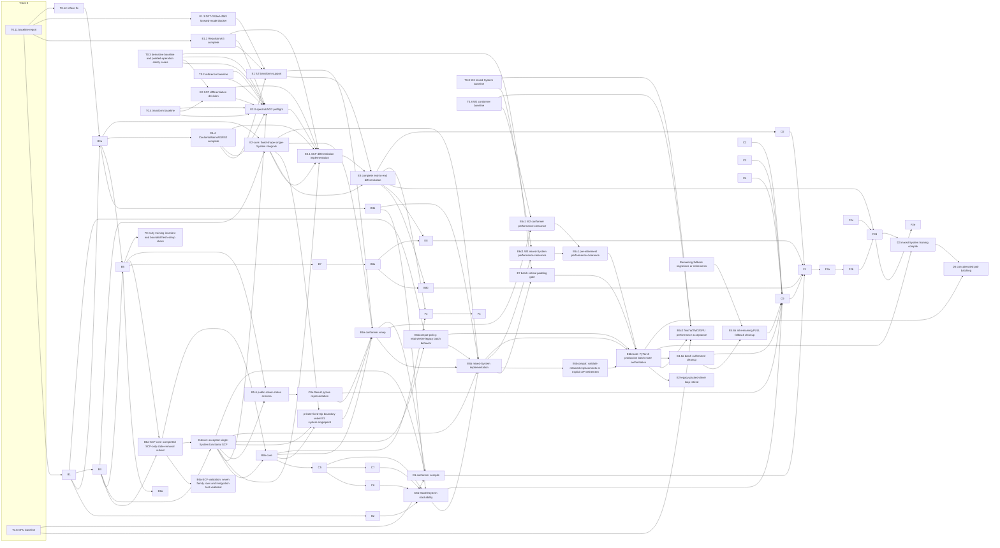

# dxtb restructuring: design goals and action plan

This is the top-level document of the action plan. It states what dxtb should be able to do, the principles every change follows, and how the work is split into tracks. Each track has its own file with work packages.

| File | Track | Purpose |
| --- | --- | --- |
| `00-overview.md` | none | Goals, principles, track map, dependencies, releases |
| `01-T0-baseline.md` | T0 | Everything tested, measured or fixed before any refactor starts |
| `02-TB-evaluation-api.md` | TB | Model/system/result split, results instead of caches, fields as inputs |
| `03-TC-node-migration.md` | TC | Replace `TensorLike` with frozen pytree nodes; retire `TensorLike` |
| `04-TE-differentiable-core.md` | TE | Higher-order and forward-mode derivatives, static shapes, batching through `vmap` |
| `05-TF-machine-learning.md` | TF | Parameter training (including new elements) and ML terms in the SCF |
| `06-TD-performance.md` | TD | Compiling and other performance work, driven by measurements |

The original code references point to upstream `grimme-lab/dxtb` at
`46af7bc`. They are historical starting points. The current restructuring
branch has moved substantially since then; `T0-baseline-report.md` section 9a
and `07-current-state-and-execution-plan.md` define the current starting point.
Do not implement a package from the old line references without first checking
the current source. Package IDs in these files supersede the IDs used in earlier review discussions.

---

## 1. Design goals

### G1: Higher-order derivatives

Compute third-order quantities reliably and at reasonable cost:

- third-order geometric force constants (∂³E/∂R³);
- first and second hyperpolarizabilities (∂³E/∂F³ and higher);
- mixed derivatives with respect to geometry, field and parameters (dipole and polarizability derivatives for IR and Raman; derivatives of forces with respect to parameters, for force matching).

**Acceptance:** for GFN1 and GFN2 on the reference set (T0.2), third-order geometric derivatives match finite differences of analytical Hessians, and hyperpolarizabilities match finite differences of polarizabilities, within tolerances fixed in T0.3. Forward-mode derivatives (`jvp`, `jacfwd`) work end to end.

### G2: Efficient batching

Two cases:

- **Conformer ensembles** (CREST-style): same composition, many geometries. One system, batched positions.
- **Mixed-composition batches** for training: padded and stacked systems.

**Acceptance:**

- conformer throughput at least matches the current `batch_mode = 2` on the T0.8 workloads (target fixed after T0.8);
- per-system derivatives contain no cross-system blocks;
- no per-entry Python loops in the canonical authoritative PyTorch batching
  route. A retained libcint eager/reference compatibility composition may use
  an outer loop over independent single-System calls; it is outside G2's
  production architecture and throughput acceptance.

**G2 driver scope.** PyTorch is the authoritative transform/batching driver
for E6a, E6bimpl/E6broute, E6c1/E6c2, and G2. The public API shape remains backend-independent:
conformers use the B1 `vmap(system.singlepoint)` expression. Libcint remains an
eager/reference/analytical backend within its documented capabilities. Any
retained libcint batch compatibility API may compose independent
single-System calls with an outer Python loop, but it is not the authoritative
G2 production route and does not satisfy G2 no-loop or throughput criteria.

### G3: Parameter learning, including new elements

- Train existing GFN1 and GFN2 parameters against reference data.
- Create parametrizations for new elements (actinides, Z = 89–103): start from defaults, train on a reference set, export a parameter file.
- Elements 1–86 stay bit-identical unless explicitly trained.

**Acceptance:** a documented workflow takes a default parameter file and a dataset to trained actinide parameters. A held-out validation passes, and parameters for elements 1–86 are verifiably unchanged.

### G4: ML contributions in the SCF

A machine-learned contribution to the Fock matrix:

- defined through an energy, so that forces and derivatives are consistent;
- trainable jointly with physical parameters;
- usable with batching and higher-order derivatives.

**Acceptance:** an example ML term converges in the SCF, its forces match finite differences, and its weights train with `torch.func`.

### G5 (secondary): Performance through compiling

Compiling is used where measurements show a benefit (TD). It is not a goal in itself and never drives design decisions against G1–G4.

### Non-goals

- Backward compatibility of the Python API. Breaking changes are allowed and are collected into one stable restructuring release (section 8).
- Float32 for the physics. Higher-order derivatives and SCF convergence need float64.
- Removing libcint from dxtb is not a goal. For transform acceptance, follow
  the canonical PyTorch G1 driver contract in Track E; libcint remains an
  eager/reference/analytical backend within its supported capabilities.

---

## 2. Constraints

- **Precision.** Float64 throughout the physics. ML components run in float64, or cast internally and return float64.
- **Python.** Python ≥ 3.10 once `Node` lands (frozen `kw_only` dataclasses).
- **Torch.** torch ≥ 2.4 for eager use. The minimum version for compiled use is decided in TD.
- **Current tad stack.** The restructuring branch runs on tad-mctc 0.9.1 and
  tad-multicharge 0.7.0. Node, ModuleNode and the tree helpers required by TC
  are therefore already available.
- **Temporary dispersion compatibility.** The currently used tad-dftd3 and
  tad-dftd4 releases still target older tad-mctc APIs. The branch temporarily
  bridges them with `dxtb._src.mctc_shim` and `dxtb._src.ncoord.legacy`, and
  the pinned baseline installs the dispersion packages with `--no-deps`.
  This is a development arrangement, not a releaseable dependency state.
  A dxtb restructuring release is blocked until compatible dependency
  releases are installed normally and both shims are deleted.
- **Pytrees, not `nn.Module`.** Containers are frozen dataclasses registered as pytrees (`Node`). `nn.Module` was rejected because of in-place conversion, inferred dtype, mutation of shared Parameters and poor fit with `torch.func`. User-supplied `nn.Module`s (ML terms) are wrapped (C1b).

---

## 3. Architecture principles

Every work package follows these principles. Reviews check against them.

**P1. Three levels: model, system, result.**

- **Model:** parameters and frozen settings, independent of any molecule. Holds per-element tables. Shared by many systems.
- **System:** `model.setup(numbers)`. Holds everything required by evaluation
  that depends on the composition and Model parameters: structural indices,
  basis/setup data and gathered parameter tensors. It does **not** store the
  complete Model. The gathered tensors retain their autograd relationship to
  Model parameter leaves; training reconstructs System from the current Model
  inside the differentiated loss.
- **Result:** `system.singlepoint(positions, chrg, spin, field, field_grad)`. A frozen object with energies and SCF outputs.

**P2. Single-system core; batching through `vmap`.**

- Physics code handles one system, possibly padded, with no batch dimension.
- Conformers: `vmap(f, in_dims=(None, 0))(system, positions)`.
- Mixed sets: stacked padded systems, `in_dims=(0, 0)`.
- Hand-written batching exists only in the SCF driver loop and inside batching rules for operations `vmap` can't handle (C extensions, custom autograd functions).

**P3. Setup path versus per-call path.**

- Data-dependent operations (`unique`, `nonzero`, boolean indexing, anything that decides array shapes) are allowed only in setup.
- The per-call path has fixed shapes for a given composition. Distance cutoffs are masks, not shape decisions.

**P4. No hidden state.**

- No persistent caches, and no mutation after construction.
- Objects are frozen; changes go through `replace()` or construction.
- Anything reused across calls is an explicit value: the system or the result.

**P5. External perturbations are inputs.** Positions, total charge, spin, electric field and field gradient are arguments of `singlepoint`, never mutable component state.

**P6. Every term is defined by an energy.** Every contribution, including ML terms, defines an energy. Potentials and Fock contributions are derivatives of that energy, analytic or by autograd, and must be consistent with it.

**P7. Differentiable to third order, including forward mode.** Every operation on the per-call path supports reverse mode to third order, forward mode and `vmap`. Custom autograd functions provide `jvp` and vmap rules, or are replaced by plain torch code.

**P8. Padding is safe.** Masked terms use the double-`where` pattern, so derivatives stay finite to third order on padded systems.

**P9. Per-molecule values are tensors.** Pytree context holds only method-level settings, never per-molecule values. Systems with different compositions then have identical tree structure and can be stacked.

**P10. Measure first.** No optimisation without a profile (T0.8). Compiling targets the SCF step and the outermost transformed function, never the inside of an autograd chain.

---

## 4. Target API sketch (illustrative)

B1 makes the binding decision. This sketch only shows the shape implied by P1–P5.

```python
import torch
import dxtb

model = dxtb.GFN2(dtype=torch.float64, device=device)   # parameters + settings
system = model.setup(numbers)                            # numbers-only data

res = system.singlepoint(positions, chrg=0, spin=0)      # frozen result
res.energy, res.charges, res.density

f = dxtb.forces(system, positions)                       # property functions
k3 = dxtb.third_order(system, positions)                 # torch.func underneath
beta = dxtb.hyperpolarizability(system, positions, field=torch.zeros(3))

# conformers: one system, batched positions (the B1 public contract)
results = torch.func.vmap(system.singlepoint, in_dims=(0,))(conformers)
energies = results.energy

# training: parameters are pytree leaves of the model
params, rest = dxtb.partition(model, trainable)
loss = lambda p: ((dxtb.combine(p, rest).setup(numbers).energy(positions) - e_ref) ** 2)
grads = torch.func.grad(loss)(params)
```

---

## 5. What gets removed

| Removed | Replaced by | Package |
| --- | --- | --- |
| `TensorLike`, `ModuleLike`, `_clone_tensorlike` | `Node` | TC |
| `batch_mode` 0/1/2, shape-based mode guessing, per-entry driver loops | B1 conformer `vmap(system.singlepoint)` (E6a) and stacked mixed-System `vmap` (E6bimpl) | E6a/E6bimpl; legacy batch mode remains until E6broute production migration |
| `CalculatorCache`, `@cdec.cache`, `opts.cache`, `store_*` flags | result object | B5 |
| `Component._cache`, `_cachevars`, `cache_is_latest`, `cache_enable`/`disable`, `update`, `reset` | per-call values, `replace()` | B6 |
| `IntDriver.is_latest`, `_positions`, stored setup state | setup returns a value | B6 |
| Electric field as a mutable component, `update_efield`, `requires_efield*` decorators | fields as inputs | B7 |
| culling in the functional single-System SCF path | fixed-shape masked loop | E4core; legacy batch cull/restore remains until E6broute migration and E4.6a cleanup |
| per-entry batch construction in the integral drivers, geometry-dependent pair shapes | PairPlan in setup, single-system driver | E2-core; packed legacy loop remains E2-legacy until E6broute |
| Calculator mixins (analytical, autograd, numerical) | property functions | B8 |
| Vendored xitorch implicit SCF | decided in E0 | E3 |

---

## 6. Tracks

| Track | File | Starts | Key outputs |
| --- | --- | --- | --- |
| T0 Baseline | `01-T0-baseline.md` | immediately | reference data, derivative status matrix, performance profile, known issues |
| TB Evaluation API | `02-TB-evaluation-api.md` | after T0.11 | model/system/result, result object, no caches, fields as inputs, property functions |
| TC Node migration | `03-TC-node-migration.md` | C1/C1b done; C5 after B6b-core structural boundary | B5.6 closes the Result/status schema; C8a proves its pytree independently; C8b supplies mixed-System stackability after B3b; C9 waits for legacy fallback retirement |
| TE Differentiable core | `04-TE-differentiable-core.md` | E0 after T0.4 | SCF differentiation, custom functions fixed, fixed-shape kernels, `vmap` batching |
| TF Machine learning | `05-TF-machine-learning.md` | F3 after B6/C1b/E3; F1 (and so F2a–F2e) last, after Tracks B, C, D and E | training workflow, new elements, ML interaction interface |
| TD Performance | `06-TD-performance.md` | E4core/E6a for conformers; E6bimpl for mixed-System profiling; D3 after F2d/E6broute | compiled conformer step, mixed-System training, conditional optimisations |

### Current status

The reviewed branch state is tracked in
`07-current-state-and-execution-plan.md`.

At the review point:

- T0 is complete except for the GPU portion of T0.8;
- B1 is agreed; B2 is implemented; B3a (structural Model/System split) is
  implemented while B3b remains open;
- B3b remains open. B4 and B5 are complete for the single-System core; B6 is
  partial (`B6a-SCF-core` is the completed E4core prerequisite, its expanded
  validation matrix is pending, and broader B6a/B6b-core plus legacy purge
  work remain); B7 is done; B8 remains open;
- E1 is partial: E1.1/E1.2 are done and E1.3 `tad-dftd3` forward-mode support
  remains blocked upstream. E2 is partial with E2-core complete and packed
  E2-legacy cleanup deferred to E6broute. E4core is accepted while
  the E4 umbrella remains partial;
- E4core (E4.0–E4.5b) is accepted; the E4 umbrella remains partial while
  E4.6a/E4.6b compatibility cleanup is blocked on its documented owners;
- Node and ModuleNode already exist upstream;
- E5 is complete;
- E2-core is complete; the E2 umbrella remains partial until E2-legacy retires;
- E0 remains a hard design gate for G1.

---

## 7. Dependencies



C1 and C1b are completed prerequisites (tad-mctc 0.9.1) and no longer graph
nodes; E5 is completed. B3 is split into B3a (done) and B3b (open), see
`02-TB-evaluation-api.md`. The old "all of B, C, D, E precede F1" path is not
the only training validation: F0 (an early training invariant) runs as soon
as B5 exists. For the detailed E4.6/E6 dependency split and the B1
conformer API implementation boundary, see `07-current-state-and-execution-plan.md`.

### Critical paths per goal

| Goal | Path |
| --- | --- |
| G1 | T0.3/T0.4 → E0 + E4core + E1.1/E1.2 → E3.0 diagnosis-only non-DFT-D3 preflight → E3.1 SCF differentiation implementation → full E3 on canonical PyTorch transform driver after full E1/E2-core (including E1.3 for outer DFT-D3) → B8b → E8 on the same driver scope (B8a after B7); libcint eager/reference regressions remain separate and enforced |
| G2 | Authoritative PyTorch route. Conformers: T0.8 W2 → E4core/B5.6/C8a/E2-core → E6a exact B1 `system.singlepoint` vmap → E6c1 W2 clearance. Mixed Systems: B3b/C5/C8b/E2-core/E4core → E6bcompat-policy → E6bimpl → E6c1 W3 clearance + batch-critical E7 + E6bcompat validation → E6broute. E6c2 W2/W3/GPU PyTorch-route sign-off closes final G2 performance acceptance. |
| G3 | T0.9 → T0.12 → B3a → B5 → F0 (early bounded invariant) → … Tracks B, C, D, E … → F1 → F2a–F2c → F2d → F2e (full workflow last by decision) |
| G4 | T0.12 → B6 → F3 (needs E3 for consistent derivatives; C1b is already available) |

The open T0.8 GPU baseline gates E6c2 final GPU/G2 performance acceptance,
not E6a correctness or CPU batch-route retirement. E6c1 clears W2 conformer
and W3 mixed-System performance separately before E6broute can retire legacy
batch FULL; its clearance may be measured acceptance or an
explicit architecture-review decision accepting a regression. Such a waiver
permits route retirement only; it does not satisfy G2's throughput target.
E6c2/G2 remains open until the documented throughput target is met or that
acceptance criterion is explicitly amended. E6c1 W2/W3 and E6c2 measurements
are for the authoritative PyTorch route; a retained libcint compatibility
loop is outside those performance gates. Missing measurements are never
clearance.

---

## 8. Releases and milestones

The restructure should not publish an intermediate API merely because the
dataclass version exists before the Node version. Prefer internal milestones
and one stable public breaking release unless a concrete downstream need
justifies two releases.

| Milestone | Gate |
| --- | --- |
| Structural-core milestone | B2-B8a; immutable Result; no core caches; fields are call inputs; T0.2 reproduced |
| Transform milestone | E0/E1/E3/E4core/C8a/E6a conformer and E6bimpl/E6broute mixed-System acceptance/E8; known-wrong G1 baseline cases resolved |
| Pytree milestone | C5-C7, C8a Result pytree, and C8b Model/System stackability; final C9 `TensorLike`/`ModuleLike` purge follows E4.6a/E4.6b legacy retirement |
| Public restructuring release | Above applicable gates plus ordinary dependency installation, no `mctc_shim`, full CI and migration guide |

The transitional `Model/System` layout is not a public API promise. Do not
publish while the dependency setup requires `mctc_shim.py` or manual
`--no-deps` installation. Use two releases only if a concrete downstream need
outweighs the cost of exposing an intermediate API. The release ships a
migration guide covering every removed or renamed public name. `main` stays
green throughout.

---

## 9. Decision notes

Short documents (one to two pages), written before the packages that depend on them:

| Note | Decides | Written in | Blocks |
| --- | --- | --- | --- |
| [B1 Evaluation API and state](B1-decision-note.md)  | model/system/result, result contents, fields as inputs, batching API, parameter storage | TB | all of TB, C8a/C8b, F2a |
| E0 SCF differentiation | E0a canonical SCF differentiation path (unrolled versus implicit; replacement for xitorch); E0b degenerate/small-gap eigensolver response; E0c NO2 ownership boundary (diagnosis E3.0, fix E3.1; no cause/fix owned by E0). PyTorch multipole integrals are done (E5) | TE | E3 |
| F2a Element structure | shell layout for actinides; which parameters are structural and which trainable | TF | F2b–F2e |
| D4 Compile policy | minimum torch for compiled use; enforcement | TD | D-track releases |

---

## 10. Working agreements (definition of done for every package)

1. **Tests move with the code.** A package that changes an API rewrites the affected tests in the same PR.
2. **Reference data is reproduced.** The T0.2 reference values are matched within the T0.3 tolerances, unless the package documents a deliberate change of physics.
3. **The derivative status only improves.** The T0.3 status matrix may only gain passes; any new failure blocks the merge.
4. **No new data-dependent operations in the per-call path** (P3). Reviewers check this.
5. **No `object.__setattr__` outside the `Node` base.** Enforced by a CI grep.
6. **Documentation.** Changelog entry, docstrings and the migration-guide section are updated.
7. **One concern per PR.** If a package grows beyond one reviewable PR, split it into sub-packages in its track file.

---

## 11. Glossary

| Term | Meaning |
| --- | --- |
| Node | Frozen dataclass registered as a pytree; replaces `TensorLike` (C1) |
| Child field | Pytree leaf or subtree: tensors, nodes, containers of them |
| Context field | Static method-level setting; part of the tree structure; never a tensor or a per-molecule value |
| Setup path | Code that runs once per system: may use data-dependent operations |
| Per-call path | Code that runs on every evaluation: fixed shapes, transform-safe |
| Double-`where` | Masking pattern that keeps gradients finite: mask the input before the singular operation, and mask the output again |
| Size bucket | A padded atom count (for example, a multiple of 16) used to limit distinct shapes |
| Status matrix | The T0.3 table of which derivative paths work, at which order, for which method and driver |
